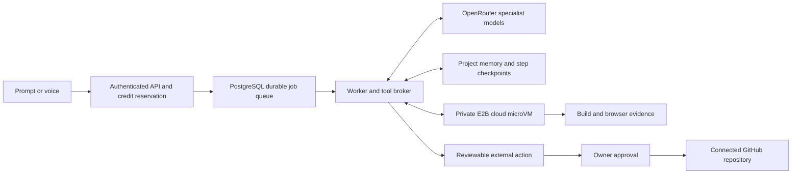

# Agent harness and economics

Implemented locally on 13 October 2026. This is a bounded application-building agent, with real tools and recorded evidence. It is not an unlimited autonomous account with every possible connector.

## Runtime

The authenticated Express control plane reserves credits, snapshots the selected routing policy, and queues an SQL job. An independent worker claims jobs with row locking. OpenRouter Responses function calls go through server-owned Zod schemas and permission checks. Project files, web pages, memory and observations are untrusted context. Model output does not grant new permissions.

Tools include file listing, reading, literal search, bounded source editing, TypeScript/build checks, real Playwright interactions/assertions/screenshots, SSRF-protected HTTPS page reading, bounded current web search, durable project notes, connected repository reads, specialist switching, and preparation of draft pull requests. There is no model-supplied host shell command. The supported environment has pinned dependencies; arbitrary dependency installation is deliberately unavailable.

The full-stack starter runs Express and PostgreSQL inside the same isolated microVM. Generated code receives only that app database credential. It never receives the platform database URI, OpenRouter key, E2B key, Stripe credentials or repository token. Protected backend acceptance checks exercise signup, invalid login, valid login, records surviving logout/login, and cross-user reads/deletes. These checks establish the recorded behavior; they are not a complete security audit of arbitrary generated code.

Completion requires successful checks and visible browser assertions on the current files. Editing files invalidates evidence. Files apply transactionally only after revision, cancellation and permission checks. Screenshots and tool observations can be inspected under Studio → Memory & actions. A passing assertion does not prove every item in a user request; the summary must describe the actual coverage.

## Models and customer plans

| Role                                     | Economy, including accounts without an active subscription | Balanced active subscription | Quality / pro active subscription |
| ---------------------------------------- | ---------------------------------------------------------- | ---------------------------- | --------------------------------- |
| UI implementation                        | GPT-6 Luna                                                 | GPT-6.1 Sol                  | GPT-6.1 Sol                       |
| Ordinary server work                     | GPT-6 Luna                                                 | Claude Sonnet 5.5            | Claude Sonnet 5.5                 |
| Architecture, auth, billing, permissions | GPT-6 Luna with the supported starter and checks           | Claude Sonnet 5.5            | Claude Opus 5.5                   |
| Research                                 | GPT-6 Luna                                                 | GPT-6 Luna                   | GPT-6 Luna                        |

This is a cost policy, not a claim that a benchmark proves one model is universally best. The customer can explicitly select an enabled OpenRouter model instead, with its larger estimate. Manual selection applies to implementation roles; research remains the inexpensive specialist. The client cannot claim a higher subscription tier. `STRIPE_PLAN_NAME` associates the configured server-side Stripe price with economy, balanced or pro; a multi-price commercial catalog is still future work. Prices and enabled model IDs are operator configuration snapshotted at enqueue time.

Automatic requests start with a role inferred from the request and supported runtime. The agent can switch roles through a validated tool; it cannot choose an arbitrary model ID. Economy allows eight model calls, other tiers twelve. Research consumes the same call budget and allows at most two searches. Context, output tokens, source storage, browser steps and runtime are capped. There is no invisible fallback to a more expensive model.

## Cost meter

`CREDITS_PER_USD=1000` defines ledger units; it does not define a retail selling price. Reservations cover the worst allowed model input/output bounds, bounded search fees, and up to ten minutes of cloud compute. With the current 2-vCPU/4-GiB image, the public E2B usage rate is approximately $0.000046/second, or $0.00276/minute, excluding the provider's subscription fee. OpenRouter-reported usage cost is preferred; otherwise token counts and snapshotted prices supply an estimate. Compute is elapsed runtime at the configured rate, not an imported E2B invoice. Unused reservations release and failed platform builds waive customer charges.

A full-stack preview is a separate, explicitly started five-minute lease for 14 credits. Reopening the current active lease does not double-charge or extend it. The sandbox auto-pauses at expiry. A frontend-only inline preview needs no such lease. This prevents endlessly running previews behind an inexpensive model call.

Commercial pricing should fund model usage, compute, the shared E2B plan, database/API hosting, support, fraud and payment fees. For example, selling 1,000 ledger credits for $1 would leave little margin when customers consume the entire allowance. A 60% gross-margin target on $1 of direct variable cost requires roughly $2.50 revenue before allocated fixed costs. Actual plan prices need measured usage distributions; no profitable economics claim is made without those data.

## Memory and interruption

Project memory uses the existing PostgreSQL database: bounded requirements, decisions, research and notes, each with provenance and a revision. No additional memory SaaS is required. It is tenant-scoped data, never system authority.

Every provider call and tool batch has a durable step record; source candidates, observations, specialist selection and evidence are checkpointed. A stopped worker pauses an agent job. The requester can resume a known safe checkpoint. An in-flight provider or mutating-tool outcome is ambiguous; resume is blocked to avoid duplicating paid calls or writes. The requester can cancel and release the reservation. External actions similarly record unknown outcomes instead of silently retrying.

## Cloud operation

E2B is the cloud computer, not the LLM or complete harness. Its processes can continue while the laptop is off within the configured lifetime, and paused state can be resumed. This app's API, SQL job worker and database still need cloud hosting for the agent to keep making decisions when the laptop is off. Local servers on 7011/7012 are development services. No production account deployment has been performed.

Sources: [E2B persistence](https://docs.e2b.dev/sandbox/persistence), [E2B pricing](https://e2b.dev/pricing), [OpenRouter function calling](https://openrouter.ai/docs/guides/features/tool-calling), [OpenRouter search tools](https://openrouter.ai/docs/guides/features/server-tools/web-search).

Failed jobs still consume the server's funded provider-cost budget even when their customer charge is waived. Increasing a user spending preference cannot create more provider funding. Worker claims use a new execution token; previous workers are fenced from resuming or applying source after ownership changes.
