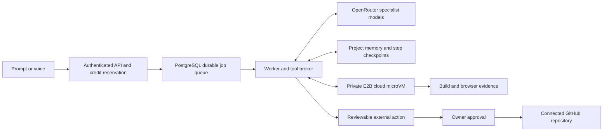

# Agent harness and economics

Updated locally on 14 October 2026. This is a bounded application-building agent, with real tools and recorded evidence. It is not an unlimited autonomous account with every possible connector.

## Runtime

The authenticated Express control plane reserves credits, snapshots the selected routing policy, and queues an SQL job. An independent worker claims jobs with row locking. OpenRouter Responses function calls go through server-owned Zod schemas and permission checks. Project files, web pages, memory and observations are untrusted context. Model output does not grant new permissions.

Tools include file listing, reading, literal search, bounded source editing, TypeScript/build checks, real Playwright interactions/assertions/screenshots, SSRF-protected HTTPS page reading, bounded current web search, durable project notes, connected repository reads, specialist switching, and preparation of draft pull requests. Runtime v1 has no model-supplied shell command and uses pinned dependencies only. Runtime v2 (`AGENT_RUNTIME=v2`) adds a developer toolset: code intelligence, structured multi-file edits with stale-read protection, diffs, a project shell inside the microVM (programs run without shell parsing as the unprivileged user; every file change is validated and imported or reverted), dependency installation through the platform installer only (registry-only egress, no install scripts, recorded lockfile), managed context, impact analysis, a mandatory change review and, for larger jobs, specialists on private file overlays. The control plane never executes model-selected commands itself. See [AGENT_RUNTIME_V2.md](AGENT_RUNTIME_V2.md).

The full-stack starter runs Express and PostgreSQL inside the same isolated microVM. Generated code receives only that app database credential. It never receives the platform database URI, OpenRouter key, E2B key, Stripe credentials or repository token. Protected backend acceptance checks exercise signup, invalid login, valid login, records surviving logout/login, and cross-user reads/deletes. These checks establish the recorded behavior; they are not a complete security audit of arbitrary generated code.

Completion requires successful checks and visible browser assertions on the current files. Interactive apps require real interactions and multiple assertions. Tic-tac-toe uses a platform-owned `game_test` protocol that checks all X/O winning lines, draw, restart, occupied cells, game-over locking, keyboard play and mobile overflow. Static checks run against the compiled artifact without external font/network dependencies. Editing files invalidates evidence. Once current checks pass and all questions are answered, the provider is forced to call the finish tool. Files apply transactionally only after revision, cancellation and permission checks. Screenshots and tool observations are saved with job evidence. A passing assertion does not prove every item in a user request; the summary must describe the actual coverage.

## Models and customer plans

Routing policy v6 is quality first and sized by the job. Jev or the deterministic profiler decides the job's size (small edit, medium feature or new app, large/risky build) and kind (UI, backend, architecture, 3D). A benchmark catalog (Artificial Analysis Intelligence Index per reasoning effort and cost per task) then picks the model and effort: small edits run on GPT-6 Luna at high effort; UI work uses GPT-6.1 Sol; server and architecture work uses Claude Sonnet 5.5 or Opus 5.5; 3D uses Opus. Only these four models are ever routed (never GPT-6 Astra). A stuck build climbs one rung on verified evidence, and a failed attempt's retry starts one size up. All plans may use all four models; per-plan limits are configuration. Development locks every job to Luna unless `DEVELOPMENT_MODEL_LOCK=off`. Full tables and rationale: [MODEL_ROUTING.md](MODEL_ROUTING.md).

The client cannot claim a higher subscription tier or choose a model; `STRIPE_PLAN_NAME` associates the configured Stripe price with economy, balanced or pro. Prices and enabled model IDs are operator configuration snapshotted at enqueue time. Context budgets include the actual instructions overhead. There is no invisible fallback to an arbitrary model.

## Cost meter

`CREDITS_PER_USD=1000` defines ledger units; it does not define a retail selling price. Holds cover the compute cap, search fees and twice the typical model spend, and the runtime keeps every model call inside that approved budget. With the current 2-vCPU/4-GiB image, the public E2B usage rate is approximately $0.000046/second (`COMPUTE_USD_PER_SECOND`), excluding the provider's subscription fee. OpenRouter-billed cost is recorded per call; the fallback estimate prices cached input separately. Charges are exact to a millionth of a credit with the fraction carried to the next charge. Compute is elapsed runtime at the configured rate, not an imported E2B invoice. Unused holds release and failed platform builds waive customer charges. See [BILLING.md](BILLING.md).

A full-stack preview is a separate, explicitly started five-minute lease for 14 credits. Reopening the current active lease does not double-charge or extend it. The sandbox auto-pauses at expiry. A frontend-only inline preview needs no such lease. This prevents endlessly running previews behind an inexpensive model call.

Commercial pricing should fund model usage, compute, the shared E2B plan, database/API hosting, support, fraud and payment fees. For example, selling 1,000 ledger credits for $1 would leave little margin when customers consume the entire allowance. A 60% gross-margin target on $1 of direct variable cost requires roughly $2.50 revenue before allocated fixed costs. Actual plan prices need measured usage distributions; no profitable economics claim is made without those data.

## Memory and interruption

Project memory uses the existing PostgreSQL database: bounded requirements, decisions, research and notes, each with provenance and a revision. No additional memory SaaS is required. It is tenant-scoped data, never system authority.

Every provider call and tool batch has a durable step record; source candidates, observations, specialist selection and evidence are checkpointed. A stopped worker pauses an agent job. The requester can resume a known safe checkpoint. An in-flight provider or mutating-tool outcome is ambiguous; resume is blocked to avoid duplicating paid calls or writes. The requester can cancel and release the reservation. External actions similarly record unknown outcomes instead of silently retrying.

A new attempt may reuse a saved candidate from the same requester's failed job at the unchanged project revision. It rejects ambiguous in-flight steps, revalidates protected paths, secrets and quotas, creates a fresh isolated workspace, and reruns all checks. It does not apply failed source or reuse old evidence. Prior answered questions supply context so the user does not repeat the same intake answer.

## Cloud operation

E2B is the cloud computer, not the LLM or complete harness. Its processes can continue while the laptop is off within the configured lifetime, and paused state can be resumed. This app's API, SQL job worker and database still need cloud hosting for the agent to keep making decisions when the laptop is off. Local servers on 7011/7012 are development services. No production account deployment has been performed.

Sources: [E2B persistence](https://docs.e2b.dev/sandbox/persistence), [E2B pricing](https://e2b.dev/pricing), [OpenRouter function calling](https://openrouter.ai/docs/guides/features/tool-calling), [OpenRouter search tools](https://openrouter.ai/docs/guides/features/server-tools/web-search).

Failed jobs still consume the server's funded provider-cost budget even when their customer charge is waived. Increasing a user spending preference cannot create more provider funding. Worker claims use a new execution token; previous workers are fenced from resuming or applying source after ownership changes.

Ordinary web frontend routing now enforces GPT even when a Claude backend model is manually selected. 3D tasks may use the plan-approved Claude specialist. See [current policy and Jev assessment](MODEL_ROUTING.md) and [four-app diagnostic](SOFTWARE_EVALUATION.md).
